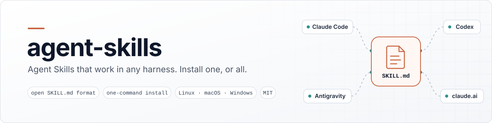

<div align="center">

<picture>
  <source media="(prefers-color-scheme: dark)" srcset="docs/assets/banner-dark.svg">
  
</picture>

**Reusable skills for coding agents and chat assistants. Write one `SKILL.md`; use it in every harness.**

[](https://github.com/ThaminduMiuranda/agent-skills/releases) [](LICENSE) [](https://agentskills.io) [](install.py)

[Skills](#skills) · [Quick start](#quick-start) · [Install](#install) · [Compatibility](#compatibility) · [Add a skill](#add-a-skill)

</div>

## Skills

### 🔗 [`harness-comms`](docs/harness-comms.md)

Lets a claude.ai chat and your local coding agents work on one project together through a shared
file-based mailbox, `comms/`. Messages carry real timestamps, chat acknowledges what it reads, and no
agent archives another's unread mail.

**Use when**
- you plan in a claude.ai chat but build with Claude Code, Codex or Antigravity
- two or more agents work on the same repo and need to hand tasks to each other
- you want an audit trail of who asked what, and when

**What you get:** a `comms/` folder, a `check-comms` skill for each harness, and an uploadable skill
for claude.ai. &nbsp;→ [Docs](docs/harness-comms.md) · [Protocol](skills/harness-comms/references/protocol.md)

> More skills are on the way. Each one lives in `skills/<name>/` and installs on its own.

## Quick start

**1. Install** the skill from your project folder. Add `-g` to install it for your user instead:

```bash
npx skills add ThaminduMiuranda/agent-skills --skill harness-comms
```

**2. Ask your agent** in the same folder:

```text
Set up harness-comms for this project with claude.ai chat, Claude Code and Antigravity.
```

It confirms the parties with you, scaffolds `comms/`, and tells you the exact check-in command for
each agent, plus the three steps to connect your claude.ai chat.

## Install

**With `npx skills`** (Node.js):

```bash
npx skills add ThaminduMiuranda/agent-skills --skill <skill>
```

**With the installer** (Python 3.9+, Linux, macOS, Windows). It installs into every harness it finds:

```bash
git clone https://github.com/ThaminduMiuranda/agent-skills
python3 agent-skills/install.py --skill <skill>
```

<details>
<summary><b>Installer options</b></summary>

```bash
python3 install.py                        # every skill, into every harness found on this machine
python3 install.py --skill <skill>        # one skill (repeatable)
python3 install.py --target claude-code   # claude-code, agents, codex, gemini-cli, antigravity, opencode, all
python3 install.py --project ~/my-project # project-level instead of user-level
python3 install.py --link                 # symlink, so `git pull` updates it
python3 install.py --force                # replace an existing install
python3 install.py --zip                  # dist/<skill>.zip, for uploading to a chat app
```

With `npx skills`, `--list` shows the available skills and `--skill '*'` installs all of them.

</details>

<details>
<summary><b>Without cloning</b> (curl and tar)</summary>

```bash
SKILL=<skill>; DEST=~/.claude/skills   # your harness's skills folder, see Compatibility
mkdir -p "$DEST" && curl -sL https://github.com/ThaminduMiuranda/agent-skills/archive/refs/heads/main.tar.gz \
  | tar -xz -C "$DEST" --strip-components=2 "agent-skills-main/skills/$SKILL"
```

To pin a version, replace `refs/heads/main` with `refs/tags/v0.1.0` and `agent-skills-main` with
`agent-skills-0.1.0`.

</details>

<details>
<summary><b>Let your agent install it</b></summary>

```text
Install the <skill> skill from https://github.com/ThaminduMiuranda/agent-skills
(only its skills/<skill>/ folder) wherever you load skills from.
```

</details>

<details>
<summary><b>claude.ai and other chat apps</b></summary>

Build an upload zip with `python3 install.py --zip --skill <skill>`, then upload it at claude.ai →
Settings → Capabilities → Skills. Some skills, like `harness-comms`, run scripts on your machine and
generate a separate chat skill for you to upload instead. Each skill's docs say which.

</details>

## Compatibility

| Harness | User-level skills folder | `harness-comms` |
|---|---|---|
| Claude Code | `~/.claude/skills/` | ✅ tested |
| Antigravity (IDE and `agy` CLI) | `~/.gemini/config/skills/` | ✅ tested |
| claude.ai chat (via Local devices) | upload a zip | 🟡 tested with a simulated chat |
| Codex, OpenCode, other `AGENTS.md` agents | `~/.agents/skills/` | 🟡 supported, untested |
| Gemini CLI (enterprise / API key) | `~/.gemini/skills/` | 🟡 supported, untested |
| anything else | wherever it loads `SKILL.md` folders | ⚙️ as the `generic` harness |

> [!NOTE]
> If an older skill with the same name is installed at user level, some harnesses load that copy in
> preference to a project-level one. Run `install.py --force` to replace it.

## Add a skill

```text
skills/<name>/
├── SKILL.md        # required: frontmatter `name` and `description`, then instructions
├── scripts/        # optional: code the agent runs
├── references/     # optional: docs the agent reads on demand
└── assets/         # optional: templates and files the skill copies
docs/<name>.md      # human documentation, kept out of the installed folder
```

1. Create `skills/<name>/SKILL.md`. `install.py` and `npx skills` pick it up automatically.
2. Write `docs/<name>.md`.
3. Add it under [Skills](#skills).

## License

[MIT](LICENSE) © Thamindu Miuranda
